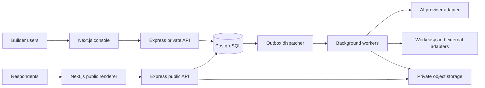

# workeasy-AI-Form-builder — build blueprint

A working multi-tenant form builder: the first usable release (backlog P0 to P1D, docs/07) is implemented, tested and deployable. The design documents below remain the specification; later phases (P2, P3) are not built yet.

Build a multi-tenant platform where organizations create forms manually or with AI, publish and share them, collect responses, and automate actions across Workeasy Helpdesk, HRMS, and AI Agent Platform. Zoho Forms is a capability reference; Workeasy uses its own identity, interface, and implementation.

## Confirmed and assumed decisions

- **Confirmed by the product owner:** Next.js frontend, Express.js backend, PostgreSQL database; both AI and manual creation; public sharing and data collection; integration into the Workeasy product family.
- **Recommended:** TypeScript throughout; pnpm monorepo; schema-driven renderer; modular Express backend; separately deployed workers; PostgreSQL transactional outbox; Redis for caching/rate limiting; S3-compatible private object storage.
- **Unconfirmed:** existing Workeasy identity provider, organization identifiers, API contracts, cloud, geography, budget, commercial plans, team capacity, and AI provider. Use adapters and the defaults in these documents. Do not invent existing Workeasy endpoints.
- **Scope:** phased Zoho-style functional coverage, not a claim of exhaustive or immediate Zoho feature parity. Features listed for later phases still require implementation specifications and tests at their phase gate.

## Read in this order

1. [Product requirements and coverage](docs/01-product-and-ux.md)
2. [Architecture, boundaries, and decisions](docs/02-system-architecture.md)
3. [Form engine and AI specification](docs/03-form-engine-and-ai.md)
4. [Data model and transaction contracts](docs/04-data-model.md)
5. [API, events, and integrations](docs/05-api-and-integrations.md)
6. [Security, reliability, and deployment](docs/06-security-and-operations.md)
7. [Implementation backlog and test gates](docs/07-delivery-plan.md)
8. [AI IDE starting instructions](AI_IDE_START_HERE.md)
9. [Research and unresolved decisions](docs/08-references-and-decisions.md)

Machine-readable starting contracts:

- [Form definition JSON Schema](contracts/form-definition.schema.json)
- [Example support form](contracts/support-request.example.json)

- [OpenAPI contract for the console and public APIs](contracts/openapi.json), generated from the code and checked in CI

## Guides

| For | Read |
|---|---|
| People building forms | **Help** in the console sidebar |
| Developers | [Local development](docs/local-development.md), [API guide](docs/api.md) |
| Operators | [Deployment](docs/deployment.md), [Operations runbook](docs/operations.md), [Backup and restore](docs/backup-and-restore.md) |
| Release readiness | [Security review](docs/security-review.md), [Accessibility](docs/accessibility.md), [Performance](docs/performance.md) |

## Recommended deployment shape



**First complete release:** sign in → create manually or with AI → validate and preview → publish → share → submit → view/export responses → deliver notification/webhook. Advanced approvals, payments, document processing, and offline collection follow in explicit phases.

## Local development

The monorepo scaffold (FND-01) is in place. See [local development](docs/local-development.md) for prerequisites and commands:

```bash
cp .env.example .env
pnpm install
pnpm infra:up
pnpm db:setup
pnpm db:seed
pnpm dev
```
