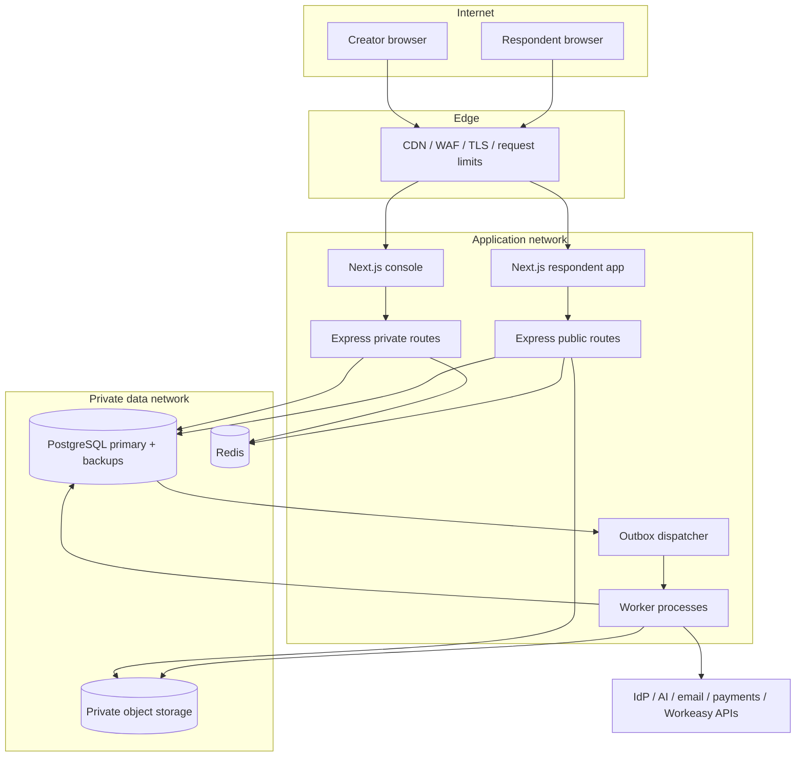

# System architecture and architecture decisions

## 1. Chosen architecture

Use a **modular monolith** for Express domain logic, two Next.js applications for console and respondent delivery, and separate background worker processes sharing versioned domain packages. Public traffic must scale independently of creator traffic. Modules communicate through application interfaces and durable events, not direct writes to each other's tables.

This avoids early distributed transactions while preserving extraction boundaries. It is the recommended initial architecture; alternative architectures are evaluated below rather than mixing incompatible choices into one implementation.

| Layer | Choice | Responsibility |
|---|---|---|
| Console | Next.js, React, TypeScript | Builder, responses, org administration |
| Respondent app | Separate Next.js app | Small accessible renderer, public routes, versioned assets |
| API | Express.js, TypeScript | Authorization, validation, transactions, public ingestion |
| Relational storage | PostgreSQL | Tenant data, JSONB definitions/answers, workflows, durable jobs |
| Query access | Typed SQL/query builder with migrations | Explicit constraints, RLS, transaction control |
| Temporary state | Redis | Distributed rate limits, disposable cache; never sole submission store |
| Binary storage | Private S3-compatible buckets | Upload quarantine, clean attachments, exports, AI source documents |
| Async execution | PostgreSQL outbox + durable jobs initially | Notifications, webhooks, AI, exports, workflow timers |
| Telemetry | OpenTelemetry-compatible stack | Traces, metrics, sanitized structured logs |
| Identity | OIDC adapter | Existing Workeasy IdP when confirmed |
| AI | Provider-neutral adapter | Validated schema proposals; optionally Workeasy AI platform |

Pin supported stable dependency versions during P0 and capture them in the lockfile. No speculative version numbers are part of this design.

## 2. Containers and trust boundaries



Private/public routes can share one deployable initially; separate listener/deploy configuration uses the same modules when load requires it. Database and object storage are not internet-readable. Use distinct database roles for migrations, private requests, public ingestion, and workers. External network calls happen outside database transactions.

## 3. Backend modules

| Module | Owns | Interfaces/events |
|---|---|---|
| Identity and tenancy | Membership, grants, org mapping | `authorize`, `resolveTenant` |
| Forms | Form lifecycle, drafts, versions | `saveDraft`, `publish`, `form.published.v1` |
| Runtime | Access policies, session issuance, public projection | `startSession`, `resolveVersion` |
| Submissions | Validation, answer records, response revisions | `accept`, `submission.accepted.v1` |
| Files | Upload claims, scan state, download authorization | `claimUpload`, `file.scan_completed.v1` |
| AI authoring | Generation jobs, proposal validation, cost | `generate`, `proposePatch` |
| Automation | Workflow snapshots, runs, steps, timers | `startRun`, `decideApproval` |
| Integrations | Connections, mappings, deliveries | `deliver`, `integration.delivery_failed.v1` |
| Reporting | Authorized query projections, export jobs | `queryResponses`, `requestExport` |
| Billing and usage | Entitlements, reservations, metering | `reserve`, `consume`, `release` |
| Audit and governance | Audit events, retention, deletion jobs | `appendAudit`, `purge` |

## 4. Monorepo boundaries

```text
apps/
  console/                 # Next.js authenticated creator UI
  respondent/              # Next.js public form runtime
  api/                     # Express routing, middleware, module composition
  worker/                  # durable jobs, timers, outbox, adapters
packages/
  form-schema/             # JSON Schema, typed definitions, migrations
  form-engine/             # pure normalization, rule and validation engine
  form-renderer/           # shared React runtime used by preview and respondent
  builder/                 # editor commands, selection, history, AI diffs
  ui/                      # Workeasy tokens and primitives
  auth/                    # permission checks and IdP interfaces
  database/                # migrations, repositories, tenant transaction wrapper
  events/                  # versioned event envelopes
  integrations/            # adapters; no browser imports
  observability/           # logging/metrics helpers
  test-fixtures/
infra/                     # containers, local compose, cloud IaC after choice
contracts/                 # schemas and OpenAPI
docs/
```

Browser packages must never import database or secret-bearing adapters. Express owns domain validation even if Next.js performs UI validation. Do not implement a second business API through Next.js route handlers; use handlers only for necessary session/BFF concerns.

## 5. Publication lifecycle

`draft -> published -> closed -> archived`; a published form can also have a newer mutable draft. Lifecycle belongs to the form, immutable snapshots belong to versions. Deletion is a separate governed operation.

Publish transaction:

1. Authorize publisher; verify draft revision via `If-Match`.
2. Validate schema, rule DAG, field references, limits, theme, translations, and integration mapping types.
3. Compile a safe public projection excluding credentials, workflow actions, internal metadata, and secret defaults.
4. Insert immutable version and workflow configuration snapshot; update active version pointer.
5. Append audit and outbox event; commit.
6. Invalidate the short-lived slug cache asynchronously. Submission API still consults authoritative access state.

Version-qualified schemas are immutable and can be cached. Slug resolution has a short TTL (initially 30 seconds); private forms use `private, no-store`. Closing a form revokes new and existing submit permission immediately at ingestion even if a page remains cached.

New sessions bind to the current version. Existing sessions can submit an older version for their two-hour session lifetime unless explicitly revoked. Rollback selects an existing immutable version for new sessions and records an audit entry. Deleted field IDs remain meaningful for old submissions. Breaking type changes create a new field ID.

## 6. Submission sequence

```mermaid
sequenceDiagram
  participant R as Respondent
  participant API as Public API
  participant DB as PostgreSQL
  participant W as Worker
  participant X as Destination
  R->>API: Start session for slug
  API->>DB: Resolve access and active version
  API-->>R: Session capability + version projection
  R->>API: Answers + session + idempotency key
  API->>DB: Begin; recheck access/version; lock session
  API->>DB: Validate, reserve quota, claim clean files
  API->>DB: Insert response + outbox + receipt
  API->>DB: Commit
  API-->>R: 201 receipt
  W->>DB: Claim durable event/job
  W->>X: Deliver with stable dedupe key
  X-->>W: Result
  W->>DB: Persist outcome/retry schedule
```

Never report submission success before commit. Delivery can be at least once; do not promise exactly-once external side effects. Payment-required forms use a separate pending-payment state described in the integration document.

## 7. Architecture alternatives and triggers

| Option | Appropriate when | Tradeoff / decision |
|---|---|---|
| Modular monolith + workers | Initial product and small/medium team | Chosen; simple ACID boundaries with clear modules |
| Microservices | Measured bottlenecks or independently owned teams | Extract ingestion, automation, AI, analytics separately; introduces distributed contracts and operational cost |
| Serverless API/workers | Bursty workload, mature managed platform | Possible hosting option; need connection pooling, timeout-aware jobs, cold-start testing |
| Dedicated tenant database | Contractual isolation/residency requirements | P3 tier; migration and fleet management cost |
| Shared tables with RLS | Default SaaS | Chosen; requires strict tenant context and testing |
| Schema per tenant | Small tenant count with special requirements | Not preferred; migrations and connection behavior become difficult |
| Event sourcing | Full replay is a core business requirement | Not chosen; immutable snapshots + audit + outbox satisfy current requirements |
| Managed workflow engine | Complex durable workflows outgrow DB state machine | P3 evaluation; retain versioned workflow contracts |
| Native mobile app | Device integrations and robust field collection | P3; responsive web precedes offline commitments |

Scale using measured p95 latency, queue age, DB lock time, and per-tenant contention. First increase app replicas and tune queries; then isolate worker pools and read/reporting paths; partition large response/event tables when query/maintenance evidence supports it. Use one writable home region per tenant before considering multi-region writes.
