# Form engine and AI authoring

## 1. One canonical definition

Manual editing, AI creation, templates, preview, publishing, and rendering all use the same versioned JSON definition. The initial structural contract is in `contracts/form-definition.schema.json`. Server validation additionally enforces uniqueness, references, graph validity, bounds, permissions, and plan capabilities. Structural JSON validation alone is insufficient.

Separate three concepts:

- `schemaVersion`: engine/document format version, initially `1.0`.
- `draftRevision`: optimistic concurrency number for a mutable draft.
- `formVersionId`: immutable published snapshot referenced by a submission.

Stable field IDs are opaque server-issued identifiers. Labels are display text and may change without changing identity. Never key stored answers by field label or array index. Choice options also use stable IDs. A removed/replaced option must remain readable in historical versions.

### Definition shape

```text
FormDefinition
  schemaVersion, title, description, locale
  pages[]: {id, title, fieldIds[]}
  fields[]: {id, type, label, helpText, required, settings}
  rules[]: {id, when, action}
  theme: {accent, background, text, radius}
  success: {message}
```

Access policies, integration secrets, publication dates, workflow definitions, quotas, AI prompts, and response retention settings are separate server-side records. An organization-only form can still expose its field definition to an authenticated respondent, but never private workflow configuration.

### Field registry

Each type registers: definition validator, answer codec, blank predicate, accessible React component, server validator, export serializer, supported rule operators, and privacy defaults. Registry versions are deployed together; publishing rejects unsupported types. Arbitrary plugins or remote JavaScript are not supported.

| Field family | Answer representation | Rules |
|---|---|---|
| text/textarea/email/phone/url | UTF-8 string | Trim outer whitespace where configured; max length; no silent truncation |
| integer | Safe JSON integer | Range; overflow rejected |
| decimal (P1)/currency (P2) | Canonical base-10 string | Decimal arithmetic; currency uses currency code and minor-unit rules |
| date/time | `YYYY-MM-DD` / `HH:mm` | No implicit timezone conversion for date-only values |
| dropdown/radio | Option ID string | Must be a published valid option |
| multi_select | Array of unique option IDs | Choice count bounds; no unknown IDs |
| checkbox/consent | Boolean | Required consent means literal true; include consent-text version in receipt |
| rating | Integer | Published bounds |
| file | Array of upload IDs | Session ownership, clean scan, count/size/type bounds |
| signature (P2) | Authorized file reference + capture metadata | Signature image does not itself establish legal e-signature status |
| repeating group (P2) | Array of `{rowId, answers}` | Stable rows; bounded size; nested field path contract |
| formula (P2) | Server-derived typed value | Ignore client-provided calculated values |

Reject unknown answer keys. Omitted optional values are absent; do not convert absence to `0`, `false`, or empty date. Normalize phone numbers only when a country context exists; otherwise validate bounded input without claiming verified reachability.

## 2. Editor command model

All changes are commands: add/delete/duplicate field, move field/page, edit property, replace choices, add/update/remove rule, update theme, apply AI proposal. Each command produces a reversible local change. A duplicate gets new field/option IDs and remapped internal references; delete requires a dependency summary and removes or repairs affected rules before publication.

Autosave after 800ms inactivity; persist a full bounded draft initially. Use `PUT draft` with `If-Match: "draft-17"`. Server compares under lock, increments revision, returns a new ETag. A stale request gets `412 DRAFT_CONFLICT`; preserve local changes and show reload/compare options. Do not silently overwrite. Multi-user CRDT editing is outside P1.

Undo/redo is local session history. Reload starts a new history; immutable published versions provide persistent recovery. Theme changes are restricted tokens, sanitized asset references, and validated font selections. Arbitrary HTML/JavaScript/CSS are excluded from P1.

## 3. Rule engine

Conditions use a typed AST, never `eval`, SQL fragments, or generated JavaScript. Initial nodes: `all`, `any`, `not`, and typed comparisons. Operators: `eq`, `neq`, `gt`, `gte`, `lt`, `lte`, `contains`, `isEmpty`, `isNotEmpty`. Validator checks each operator against field type and literal type. P1 supports scalar literal comparisons; field-to-field/formula references arrive in P2.

Bound each condition AST to depth 8 and 100 total nodes during parsing, before recursive evaluation. Enforce a total definition byte limit of 1 MiB. Semantic validation also rejects settings inappropriate for a field type, inverted min/max ranges, invalid locale identifiers, duplicate option IDs, fields placed on multiple/no pages, and invalid type-specific bounds. The starter JSON Schema intentionally leaves these cross-property checks to the engine.

Actions: `setVisibility`, `setRequired`, `skipToPage`. At most one rule controls each `(target, property)` in P1. Its true and false effects are explicit. Multiple conflicting page branches from the same page are rejected at publication unless proven mutually exclusive; initially permit one branch per page. Page skips are forward only and point to an existing page. Skip rules evaluate at the end of their source page and can reference only fields on that or earlier pages.

Build dependency edges from condition fields to target fields. Reject cycles, self-references, missing references, and backward-dependent page routing. In P1, field-control rules can reference only earlier fields in form traversal order. This conservative constraint keeps client and server evaluation deterministic.

Evaluation sequence on both client and server:

1. Decode submitted values with bounded type parsers; reject unknown fields.
2. Traverse pages/fields in dependency order using the pinned definition.
3. Evaluate visibility and page reachability. A hidden/unreachable source contributes an absent value to dependent rules.
4. Remove hidden/unreachable answers from the canonical payload, even if a client sends them. Their required rules do not apply.
5. Evaluate conditional required state and validate visible reachable answers.
6. P2: compute formula DAG, validate cross-field constraints, produce pricing quote from server catalog.
7. Return canonical answers, field errors, and computed values.

Empty semantics: absent/null/empty trimmed string/empty array are empty; `false` and `0` are not empty. Comparisons on absent values are false except `isEmpty`; `neq` is also false on absent values. Date comparisons use validated canonical dates. Decimal comparisons use decimal arithmetic. Do not allow arbitrary regular expressions from authors in P1; offer predefined safe patterns.

### Shared engine tests

Create a fixture corpus of definitions, raw answers, expected visible fields, canonical answers, and errors. Run unchanged in Node and browser tests. Include tampered hidden answers, removed choices, boundary dates, Unicode, false/zero, page skips, stale versions, and cyclic rule proposals.

## 4. AI architecture

Zoho's public AI reference includes prompt generation, document conversion, translation, and content assistance. Workeasy's pipeline below is an independent proposed implementation. See [official AI overview](https://help.zoho.com/portal/en/kb/forms/ai/articles/ai-features-in-zoho-forms).

```mermaid
flowchart LR
  Prompt[User prompt / approved document] --> Auth[Authorize + reserve AI budget]
  Auth --> Job[Durable generation job]
  Job --> Adapter[AI provider adapter]
  Adapter --> Parse[Strict structured output parse]
  Parse --> Schema[Schema + semantic validation]
  Schema --> Diff[Draft proposal and field diff]
  Diff --> Review[User accepts or rejects]
  Review --> Save[Optimistic draft write]
```



AI interface:

```ts
interface FormAuthoringProvider {
  generate(input: {
    prompt: string;
    locale: string;
    allowedFieldTypes: string[];
    limits: { maxFields: number; maxPages: number; maxRules: number };
    baseDefinition?: unknown;
    signal: AbortSignal;
  }): Promise<{ proposal: unknown; usage: { inputTokens: number; outputTokens: number } }>;
}
```

Provider SDKs and prompts are server-only. Reuse Workeasy AI Agent Platform if it exposes suitable structured generation and tenant-scoped budget APIs; otherwise implement an adapter against an approved provider. The exact endpoint is unresolved. Manual forms and runtime do not depend on AI availability.

### Generation job contract

Job records capture tenant/user, base draft revision, operation, model/provider identifier, prompt-template version, input digest, status, validated proposal, usage, and sanitized failure code. States: `queued -> running -> succeeded | failed | cancelled`; leases permit retries after worker failure. Cancellation is best effort for in-flight provider charges but guarantees no automatic draft mutation.

Initial limits: prompt <= 8,000 characters; one active generation per user and five per tenant; provider timeout 45s; total job deadline 120s; one schema repair attempt; at most two transient retries with jitter within deadline. Reserve worst-case allowed token budget before enqueue; settle actual reported usage and release unused reservation. Reconcile unknown provider outcomes before crediting refunds. Enforce tenant daily limits and global spend alarms.

Structured output is untrusted. Generate temporary identifiers, then normalize to server IDs; preserve allowed existing IDs during edits. Validate prohibited fields/types, all references, rule DAG, text lengths, markup, and supported enum values. Invalid output becomes an actionable failed proposal, never a partly published form.

### AI edit application

Proposal includes base revision, proposed definition, changes summary, and warnings for deletions/type changes. UI computes a field-level diff from canonical documents. Accept requires `forms.edit`, expected draft revision, and a revalidation. If draft changed, reject with conflict and offer regenerate against current draft. Publication remains a distinct human action.

### AI data and safety boundary

- No submission answers in authoring prompts by default. Response summarization is a separate opt-in feature requiring response-read permission and field masking.
- Uploaded documents and their text are untrusted data, not system instructions. Prompt injection cannot grant tool access or alter permissions.
- Model has no database, publishing, outbound email, payment, or credential tools.
- No unsupported claims that generated consent wording is legally sufficient.
- Redact secrets; keep prompt/response content out of logs. Default operational logs retain metadata only. Tenant-visible source documents expire after 24 hours unless deliberately retained; use a scheduled purge.
- Provider retention, geography, and training terms must be approved before enabling confidential-data features. Do not copy Zoho's provider claims onto Workeasy.

### P2 document conversion and translation

Upload to quarantine → type/size/virus validation → sandboxed document extraction/OCR → field candidate proposal with source-page references → schema validation → human review. Initial import caps: 10 MiB, 20 pages, 60s extraction deadline; reject encrypted/unreadable files with a clear reason. OCR uncertainty is exposed per field; never silently claim exact reproduction.

Translations store locale-specific labels/help/errors keyed by stable field/option IDs, with source text hash and human approval state. Structural edits mark affected translations stale. Fallback locale is explicit. OCR respondent autofill requires respondent review before submission and must not assert identity verification.

## 5. Engine evolution

Schema migrations are pure versioned functions tested with archived fixtures. Old versions remain renderable until explicitly migrated through a new publication. Do not mutate old definitions or reinterpret historical answers. P2 contracts extend the schema using a new format version when semantics change. Feature flags cannot make an already published type disappear; renderer support is retained through its support window.
