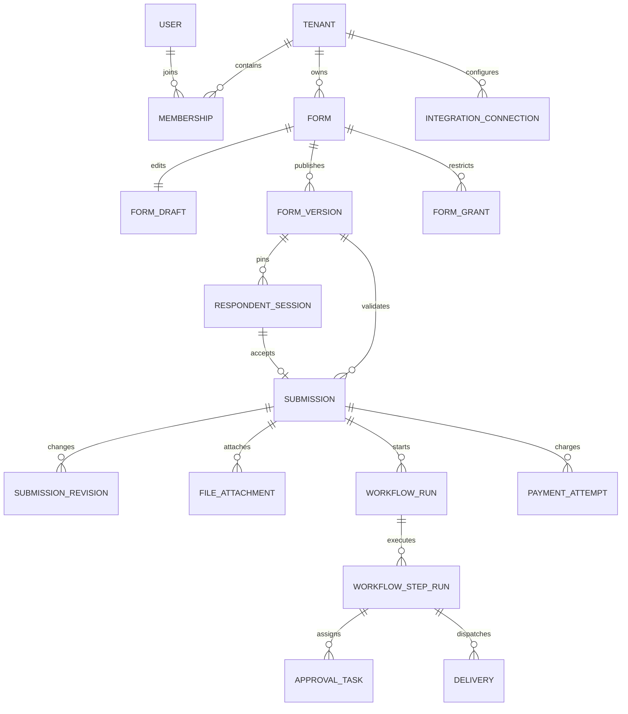

# Data model and transactional invariants

## 1. Conventions

PostgreSQL is authoritative. Use UUID primary keys, `timestamptz` timestamps, explicit enums/checks, and `tenant_id NOT NULL` for tenant-owned rows. Global user identities have no response access until a membership/grant is checked. JSONB stores heterogeneous definitions and answers; relational columns store ownership, lifecycle, and query-critical attributes.

For every tenant-owned reference, use composite foreign keys `(tenant_id, parent_id)` referencing unique `(tenant_id, id)`. Child records also constrain form/version/session consistency where relevant. Never rely only on UUID unpredictability. For example, submissions carry tenant, form, and version with a composite FK to that version's tenant/form/id tuple.

## 2. Entity relationship map



## 3. Data dictionary

All mutable records include `created_at`, `updated_at`; immutable records include `created_at`. Columns below supplement those conventions.

| Table | Important columns | Constraints / indexes |
|---|---|---|
| tenants | id, external_org_id, name, home_region, status, settings | Unique external_org_id when present |
| users | id, issuer, subject, display_name | Unique issuer/subject; email is not identity key |
| memberships | tenant_id, user_id, role, status | Unique tenant/user |
| form_grants | tenant_id, form_id, principal_type/id, permission | Unique form/principal/permission; validated principal ownership |
| forms | id, tenant_id, slug, name, owner_id, state, active_version_id, retention_days, access_policy_id, deleted_at | Globally unique slug, unique tenant/id; index tenant/state/updated_at |
| form_drafts | tenant_id, form_id, revision, definition JSONB, workflow_draft JSONB, updated_by | Unique tenant/form; revision >= 1 |
| form_versions | id, tenant_id, form_id, version_number, schema_version, definition JSONB, public_projection JSONB, content_hash, workflow_snapshot JSONB, published_by | Unique tenant/form/version_number; immutable rows |
| form_access_policies | id, tenant_id, mode, password_hash, open_at, close_at, max_responses, allow_old_sessions | No plaintext passwords; policy updates audited |
| respondent_sessions | id, tenant_id, form_id, form_version_id, token_hash, actor_id nullable, expires_at, revoked_at, accepted_submission_id nullable | Unique token_hash; tenant/form/version FK; one accepted response per session |
| submission_requests | tenant_id, session_id, key_hash, request_hash, submission_id, response_code, receipt_projection | Unique tenant/session/key_hash; commit with response |
| submissions | id, tenant_id, form_id, form_version_id, session_id, answers JSONB, revision, intake_state, approval_state, payment_state, received_at, deleted_at | Unique tenant/session; index tenant/form/received_at/id |
| submission_revisions | id, tenant_id, submission_id, revision, answers JSONB, actor_id, reason | Unique tenant/submission/revision; immutable |
| file_uploads | id, tenant_id, session_id or actor_id, form_id, field_id, storage_key, detected_type, bytes, scan_state, expires_at, claimed_submission_id | Opaque object key; pending/clean/infected/error; no shared public URL |
| file_attachments | tenant_id, submission_id, upload_id, field_id | Unique tenant/upload_id; ownership checked at claim |
| workflow_runs | id, tenant_id, submission_id, submission_revision, workflow_hash, status | Unique tenant/submission/revision/workflow_hash |
| workflow_step_runs | id, tenant_id, run_id, node_id, status, attempt, lease_until, next_attempt_at, output_ref | Unique tenant/run/node; index status/next_attempt_at |
| approval_tasks | id, tenant_id, step_id, assignee_id, status, decision_at, decision_by, decision_reason, expires_at | Unique step/assignee; compare-and-set pending decision |
| integration_connections | id, tenant_id, provider, display_name, credential_ref, scopes, status | Credential ref points to secret manager; no secrets in JSON definitions |
| deliveries | id, tenant_id, step_id, connection_id, event_id, dedupe_key, status, attempts, next_attempt_at, result_code | Unique tenant/dedupe_key; no raw PII in errors |
| payment_attempts | id, tenant_id, submission_id, provider_account_id, provider_payment_id, amount_minor, currency, state | Unique provider/account/payment_id; amount > 0 |
| provider_event_inbox | provider, account_id, event_id, payload_digest, status | Unique provider/account/event_id; bounded encrypted payload retention |
| ai_jobs | id, tenant_id, form_id, requested_by, base_revision, operation, state, proposal, budget_reservation_id, usage, expires_at | Index tenant/state/created_at; content retention policy |
| outbox_events | id, tenant_id, aggregate_id, event_type, payload_ref, occurred_at, dispatched_at | Index undispatched/occurred_at; payload references minimize PII |
| jobs | id, tenant_id, type, source_event_id, payload_ref, status, attempt, next_attempt_at, lease_until | Unique source_event_id/type for event-derived jobs |
| audit_events | id, tenant_id, actor_type/id, action, resource_type/id, request_id, metadata, occurred_at | Append-only runtime role; index tenant/occurred_at |
| exports | id, tenant_id, requested_by, filter_snapshot, field_projection, state, object_key, expires_at | Authorization rechecked at job and download time |
| usage_buckets | tenant_id, metric, period_start, consumed, reserved, limit_value | Unique tenant/metric/period; atomic conditional increment |
| usage_reservations | id, tenant_id, metric, quantity, state, expires_at, source_id | Unique tenant/metric/source_id |
| invitations (P2) | id, tenant_id, form_id, token_hash, identity_constraint, expires_at, consumed_by | Unique token hash; atomically consumed |
| response_drafts (P2) | id, tenant_id, session_id, encrypted_answers, resume_token_hash, expires_at | Session/version-bound; no unbounded PII retention |
| custom_domains (P3) | id, tenant_id, hostname, verification_token_hash, status, certificate_ref | Unique normalized hostname; verify before routing |

P2 additionally introduces comments, saved views, document templates, workflow definitions, billing subscriptions, and typed reporting projections. P3 introduces device registrations and sync receipts. These require phase-specific migrations rather than empty placeholder tables at launch.

## 4. Tenant isolation

Enable and FORCE RLS on tenant-owned tables. Application roles must not own tables and must not have BYPASSRLS or superuser privileges. Use an explicit transaction per tenant-scoped operation, setting context with transaction-local `set_config('app.tenant_id', tenantId, true)`. Do not use session-persistent SET with connection pooling.

Illustrative policy (repeat with both read/write semantics for each table):

```sql
ALTER TABLE forms ENABLE ROW LEVEL SECURITY;
ALTER TABLE forms FORCE ROW LEVEL SECURITY;
CREATE POLICY tenant_isolation ON forms
  USING (tenant_id = NULLIF(current_setting('app.tenant_id', true), '')::uuid)
  WITH CHECK (tenant_id = NULLIF(current_setting('app.tenant_id', true), '')::uuid);
```

Missing tenant context must return no tenant rows. RLS is a defense in depth; application authorization still checks form grants and field masks. PostgreSQL documents owner/bypass behavior in its [row security documentation](https://www.postgresql.org/docs/current/ddl-rowsecurity.html).

Public slug resolution uses a narrowly scoped locator repository/table containing only slug, tenant ID, form ID, and public routing metadata. After resolution, public API verifies the access policy and establishes tenant context. Never let the browser choose tenant context or bypass RLS. Cross-tenant background dispatch uses a dedicated minimal job-claim interface; actual jobs execute under their recorded tenant and permissions. No generic privileged SQL endpoint.

## 5. Submission transaction specification

1. Validate request sizes, capability hash/expiry, content type, and rate limit.
2. Compute canonical request digest from version, answers, and upload IDs. Begin tenant transaction.
3. Lock session. If a matching committed idempotency key exists, return its recorded receipt; if digest differs, return `409 IDEMPOTENCY_CONFLICT`.
4. If session already accepted under another key, return its existing receipt only to that same authorized capability. Do not create a second response.
5. Lock/check current form policy: not closed/deleted, acceptance window valid, session version permitted, respondent authorized.
6. Run deterministic engine; return field errors without consuming quota.
7. Conditionally increment tenant-period and form response counters if within limits. Lock counters in stable order to avoid deadlocks. Any failure rolls back all reservations.
8. Verify and atomically claim clean upload records for this session/form/field. Reject infected/pending uploads.
9. Insert submission, consent metadata, idempotency receipt, and outbox event; mark session accepted and invitation consumed when applicable.
10. Commit, then return receipt.

Initial idempotency receipt retention is 30 days; session accepted marker and unique tenant/session constraint remain as long as the submission, preventing later duplicate insertion. A retry after an expired unused session requires a new session; do not pretend it is the same accepted request. Receipt replay may be allowed for a short separate capability lifetime without granting answer read access.

## 6. Durable jobs and events

Outbox dispatcher claims committed events with `FOR UPDATE SKIP LOCKED`; inserts unique durable jobs and marks dispatched in one DB transaction. Workers claim jobs using leases, increment attempts, then perform external work outside transactions. Lease timeout requeues abandoned jobs. Completion persists outcome using lease token compare-and-set to prevent stale workers overwriting newer attempts.

Failures use exponential backoff with jitter, bounded attempts/deadline, and dead-letter state. Manual replay retains the original destination deduplication key unless a user explicitly requests a distinct new action. An external call that succeeded before a worker crash can repeat; receivers/adapters must support idempotency or show an ambiguous outcome for reconciliation.

## 7. Querying and retention

Use keyset pagination `(received_at, id)` scoped to tenant/form. JSON answer filters accept only supported operators, field IDs from the relevant version set, and parameterized values. Bound result size and query timeout. Index frequently filtered fields through an allowlisted projection pipeline; avoid unlimited user-created JSONB indexes. Cross-version reports map stable field IDs, show version-specific labels, and refuse incompatible type aggregation.

Exports snapshot filter/cutoff and authorized columns, then process bounded batches. Escape spreadsheet formula prefixes in CSV values; separate machine-oriented raw export behind an explicit option. Jobs check permission at execution and delivery; revocation invalidates access. Download expires after 15 minutes; export artifact expires after 24 hours by default.

Soft deletion prevents normal access immediately. Retention worker purges answers, files, saved drafts, projections, AI derivative content, exports, and queued payload references; audit tombstones retain non-content metadata only. Legal holds block purge where configured. Backups age out under the backup policy, and restoration replays deletion tombstones before serving traffic. Do not promise immediate physical removal from immutable backups.
